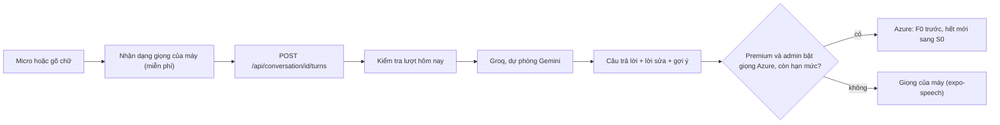

# Đàm thoại với AI

Người học nói chuyện bằng tiếng Anh với AI ngay trong app, theo **lượt**: bấm micro nói (hoặc gõ), AI trả lời ngắn, sửa câu vừa nói và gợi ý câu tiếp theo. Có hai chế độ:

- **Nhập vai theo tình huống**: gọi cà phê, hỏi đường, nhận phòng khách sạn, phỏng vấn xin việc… Mỗi tình huống có cấp độ A1–B2, vai của AI, mục tiêu cho người học và vài cụm từ gợi ý. Admin quản lý danh sách trên web admin.
- **Trò chuyện tự do**: AI là bạn nói chuyện thân thiện, tự điều chỉnh câu theo cấp độ của người học.

Cuối buổi AI tổng kết: điểm 0–100, các lỗi nên chú ý (câu gốc → câu đúng, giải thích tiếng Việt) và vài cụm từ nên học.

## Màn đàm thoại trong app

- Vào từ tab **Luyện** → thẻ *Đàm thoại với AI* → chọn cấp độ → *Trò chuyện tự do* hoặc một tình huống.
- **Hộp xin đồng ý** (Apple Guideline 5.1.2(i)): lần đầu bắt đầu một buổi, app hiện hộp *Trò chuyện với AI*: câu bạn nói / gõ (dạng chữ) được gửi tới *dịch vụ AI bên ngoài của đối tác 4UME*, không gửi ghi âm, email hay tên; link chính sách quyền riêng tư; nút *Đồng ý và bắt đầu* / *Để sau*. Chưa đồng ý thì không gửi gì. Lựa chọn lưu trên máy theo tài khoản (`fourume.aiConsent.<userId>`), nên đăng nhập máy khác sẽ hỏi lại. Hộp **không nêu tên** nhà cung cấp để đổi AI không cần cập nhật app; tên cụ thể (Groq, Google Gemini) ghi ở trang `privacy/` — đổi AI thì nhớ sửa trang đó.
- Tình huống nhập vai có khung **Mục tiêu** + cụm từ gợi ý ở đầu (chạm để ẩn).
- **Sửa ngay tại chỗ**: câu người học có lỗi ngữ pháp / dùng từ thì hiện ngay dưới bong bóng của họ khung *Nói tự nhiên hơn* (câu đúng, nút nghe, giải thích tiếng Việt). AI vẫn trả lời tiếp trong vai, không giảng giải trong câu trả lời. Phần tổng kết gom lại tối đa 5 lỗi đáng nhớ nhất, khớp với những gì đã sửa trong buổi.
  - Tính là lỗi: thiếu / sai giới từ ("waiting my friend" → "waiting for my friend"), thiếu mạo từ, sai dạng động từ, sai trật tự từ.
  - Không tính: chữ hoa, dấu câu, từ bị nhận dạng nhầm thành từ đồng âm (chữ đến từ nhận dạng giọng nói). Máy chủ cũng tự bỏ lời sửa chỉ khác chữ hoa / dấu câu.
- **Micro nghe liên tục**: bấm micro rồi nói, ngừng để suy nghĩ giữa câu không bị ngắt. Chữ hiện dần trong ô nhập, thanh dưới báo *Đang nghe… nói xong bấm ■ để gửi*. Máy gửi khi bấm ■, hoặc tự dừng sau 5 giây im lặng / 60 giây mỗi lượt. (Các màn Luyện câu, ngữ pháp vẫn dừng ở lần ngừng đầu tiên vì chỉ nói một câu ngắn.) Android 12 trở xuống không có chế độ liên tục, máy dùng thời gian im lặng dài hơn thay thế.
- Câu trả lời của AI có nút *Nghe lại*; câu mới nhất có thêm *Gợi ý trả lời* (gợi ý tiếng Việt + 2–3 câu mẫu, chạm để đưa vào ô trả lời).
- Thanh nhỏ ngay trên ô nhập: bên trái *Lượt x/20 · còn y lượt hôm nay*, bên phải nút **Kết thúc** (chỉ hiện sau câu đầu tiên, hỏi xác nhận trước khi kết thúc; khi đã đạt mục tiêu / đủ lượt / hết lượt thì vào thẳng tổng kết). Lúc AI đang tổng kết, cả màn phủ lớp *Đang tổng kết…*. Không đặt nút trên thanh tiêu đề (iOS 26 bọc nút trong khung kính, chữ dài bị chật, góc trên khó với tay).
- **Giọng của máy đổi ngẫu nhiên theo từng buổi**: đầu mỗi buổi app chọn ngẫu nhiên một giọng tiếng Anh có trên máy (Mỹ, Anh, Úc, Ireland, Canada) và giữ nguyên giọng đó cho cả buổi (câu mở đầu, mọi câu trả lời, *Nghe lại*), để AI như một người duy nhất. Buổi sau (kể cả *Luyện lại*) bốc giọng khác. Muốn nhiều giọng hay hơn: iPhone → *Cài đặt → Trợ năng → Nội dung được đọc → Giọng nói → Tiếng Anh*, tải giọng *Nâng cao*.

## Vì sao làm theo lượt (không gọi thoại thời gian thực)

| | Nói theo lượt (đang làm) | Gọi thoại thời gian thực (để sau) |
|---|---|---|
| Hợp người học A1–B1 | Có thời gian nghĩ, xem chữ, gõ thay nói, xem gợi ý tiếng Việt | Dễ áp lực, hợp B1–B2 trở lên |
| Sửa lỗi từng câu | Có sẵn vì mỗi lượt đã là chữ | Khó, phải lấy lời thoại rồi chấm sau |
| Chi phí mỗi buổi ~5 phút | ≈ 0,002–0,005 USD (chỉ tiền AI soạn câu trả lời) | ≈ 0,1 USD (Gemini Live) đến 0,3–1,5 USD (OpenAI Realtime) |
| Khi hết hạn mức | Tự chuyển sang giọng của máy, vẫn chạy | Dừng hẳn |
| Khối lượng làm | Dùng lại AI, nhận dạng giọng, giọng đọc, cơ chế lượt sẵn có | Cần thư viện native mới, bản build mới, mã truy cập tạm thời |

Gọi thoại thời gian thực có thể thêm sau như quyền lợi Premium, dùng chung danh sách tình huống và phần tổng kết.

## Luồng một lượt

- Nhận dạng giọng dùng dịch vụ của điện thoại (Apple / Google), máy chủ 4UME chỉ nhận chữ, không nhận âm thanh. Máy không có nhận dạng giọng (Expo Go, máy cũ) thì chỉ hiện ô gõ chữ.
- Máy chủ chỉ gửi kèm khoảng 12 lượt gần nhất cho AI để giảm token.
- AI trả về một JSON: câu trả lời, lời sửa (nếu câu của người học có lỗi), gợi ý tiếng Việt, 2–3 câu mẫu để nói tiếp, và đã đạt mục tiêu tình huống chưa.

## Giọng đọc câu trả lời

- **Mặc định mọi người (kể cả Premium) dùng giọng của máy**: miễn phí, không giới hạn.
- Admin có công tắc **Giọng Azure cho Premium** (mặc định tắt). Khi bật, câu trả lời của AI cho tài khoản Premium được đọc bằng giọng Azure Neural:
  1. Dùng resource **F0** (miễn phí) trước, tới trần *Ký tự F0 mỗi tháng cho đàm thoại*. F0 dùng chung 500.000 ký tự/tháng với Góc nghe, Luyện câu và giọng đọc từ, nên trần này chừa phần cho các tính năng đó.
  2. Hết phần F0 (hoặc Azure báo F0 hết hạn mức) thì dùng resource **S0** (`AZURE_SPEECH_PAID_KEY`, xem [pronunciation.md](pronunciation.md#key-trả-phí-s0)), tới trần *Ký tự S0 mỗi tháng* (khoảng 15 USD cho 1 triệu ký tự). Trần 0 = không bao giờ dùng S0.
  3. Chạm cả hai trần, hoặc Azure lỗi → app tự đọc bằng giọng của máy, buổi đàm thoại không bị gián đoạn.
- File mp3 của từng câu lưu tạm ở `/media/conversation/`, tự xoá sau 2 ngày.

## Lượt và Premium

| | Miễn phí | Premium |
|---|---|---|
| Lượt nói mỗi ngày | 10 | 100 |
| Lượt tối đa mỗi buổi | 20 | 20 |
| Giọng đọc | Giọng của máy | Giọng của máy, hoặc Azure nếu admin bật |

- **Một lượt = một câu người học gửi.** Câu mở đầu của AI và phần tổng kết không tính lượt.
- "Ngày" theo giờ máy người học (header `X-Utc-Offset`), giống chuỗi ngày học và chấm phát âm.
- Hết lượt: app hiện khung gợi ý Premium (chỉ giới thiệu, không hướng dẫn thanh toán ngoài app).
- Mỗi lượt nói tính là có học trong ngày (giữ chuỗi).

## Cài đặt (web admin → Đàm thoại → Cài đặt)

- Bật/tắt tính năng.
- Lượt mỗi ngày (miễn phí / Premium), lượt tối đa mỗi buổi.
- **Giọng Azure cho Premium** (bật/tắt), chọn giọng Azure.
- Ký tự F0 mỗi tháng cho đàm thoại, ký tự S0 mỗi tháng (trần chi tiêu).
- Thống kê trong tháng: số buổi, số người, số lượt nói, ký tự F0 / S0 đã dùng (kèm ước tính USD).
- Thay đổi có trong *Lịch sử* và khôi phục được.

## Tình huống nhập vai

Mỗi tình huống gồm:

| Trường | Ví dụ |
|---|---|
| Cấp độ | A1 |
| Tiêu đề (tiếng Việt) | Gọi đồ uống ở quán cà phê |
| Bối cảnh cho AI (tiếng Anh) | A small coffee shop in the morning. The learner wants to order a drink and pay. |
| Vai của AI (tiếng Anh) | a friendly barista |
| Mục tiêu (tiếng Việt, hiện cho người học) | Gọi một đồ uống, chọn cỡ và trả tiền |
| Câu mở đầu (tiếng Anh) | Hi! Welcome to Sunny Cafe. What can I get for you today? |
| Cụm từ gợi ý | I'd like…, Can I have…, How much is it? |

- Tình huống mẫu nằm trong `backend/data/conversation/scenarios.json`, nạp vào database lần đầu chạy (giống ngữ pháp, bài nghe). Sau đó sửa trên web admin.
- Nút **AI soạn tình huống** trên admin: chọn cấp độ, số lượng, chủ đề → AI soạn nháp, admin chọn câu muốn thêm.

## Kỹ thuật

- Bảng: `ConversationScenarios`, `Conversations`, `ConversationTurns`. Cài đặt lưu trong `AppSettings` khoá `conversation`.
- AI: `AiClient` (Groq trước, lỗi thì Gemini). Có thể đặt model riêng cho đàm thoại bằng `GROQ_CHAT_MODEL` / `GEMINI_CHAT_MODEL` (để trống = model mặc định). Đàm thoại dùng chế độ suy nghĩ thấp để trả lời nhanh.
- API app:
  - `GET /api/conversation/status` — lượt còn lại hôm nay, giọng đọc nên dùng.
  - `GET /api/conversation/scenarios` — tình huống đang hiện, theo cấp độ.
  - `POST /api/conversation` `{ scenarioId?, level }` — bắt đầu buổi, trả câu mở đầu.
  - `POST /api/conversation/{id}/turns` `{ text }` — một lượt nói. Hết lượt → 429, tắt / chưa cấu hình AI → 503.
  - `POST /api/conversation/{id}/end` — tổng kết buổi.
- API admin: `GET/POST/PUT/DELETE /api/admin/conversation/scenarios`, `POST /api/admin/conversation/scenarios/draft`, `GET/PUT /api/admin/conversation/config`, `POST /api/admin/conversation/config/reset`.
- Quyền riêng tư: chữ người học nói (đã nhận dạng trên máy) được gửi tới Groq / Gemini để tạo câu trả lời; không gửi âm thanh, không gửi email hay tên. Đã ghi trong trang `privacy/`.

## Triển khai

1. Merge nhánh `feature/ai-conversation` vào `main`, push → GitHub Actions build image API + admin.
2. VPS: `cd /opt/4ume && git pull && cd deploy/vps && docker compose pull && docker compose up -d`. API tự chạy migration `AiConversation` (3 bảng mới) và nạp 20 tình huống mẫu lần đầu. Không cần thêm biến môi trường mới (dùng `GROQ_API_KEY` / `GEMINI_API_KEY` đã có; `GROQ_CHAT_MODEL`, `GEMINI_CHAT_MODEL` là tuỳ chọn).
3. Kiểm tra: admin → *Đàm thoại AI* thấy 20 tình huống và dòng "AI trả lời: Groq …".
4. App: tính năng nằm trong mã JS nhưng app chưa có `expo-updates` (không cập nhật qua mạng được), nên người dùng chỉ thấy sau khi cài **bản build mới**. Bản app cũ vẫn chạy bình thường với API mới. Không thêm thư viện native mới (nhận dạng giọng đã có từ bản trước).

## Để sau

- Xem quảng cáo đổi thêm lượt (dùng lại `AdRewards` khi AdMob đã bật).
- Gọi thoại thời gian thực làm quyền lợi Premium.
- Lịch sử các buổi đã đàm thoại.
