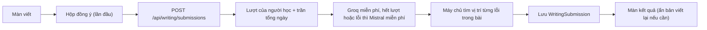

# Luyện viết với AI

Người học viết một đoạn văn tiếng Anh, AI chấm và sửa ngay trong app. Có hai cách viết:

- **Viết theo đề**: mỗi đề có cấp độ A1–B2, đề tiếng Anh, một câu hướng dẫn tiếng Việt, số từ gợi ý và vài cụm từ gợi ý. Admin quản lý danh sách trên web admin (có nút *AI soạn*).
- **Viết tự do**: người học tự gõ chủ đề (không bắt buộc), số từ gợi ý theo cấp độ.

Kết quả chấm gồm:

| Phần | Miễn phí | Premium |
|---|---|---|
| Điểm 0–100 và điểm từng mặt (ngữ pháp, từ vựng, mạch lạc, đúng đề) | Có | Có |
| Nhận xét tiếng Việt | Có | Có |
| Tô lỗi ngay trong bài, chạm để xem câu sửa + giải thích tiếng Việt | Có | Có |
| Gợi ý nâng cấp (từ / cấu trúc để lên cấp kế tiếp) | Có | Có |
| Bản viết lại cả đoạn (có nút *Nghe*) | Chỉ câu đầu, phần còn lại khoá | Có |
| Xem lại bài cũ | 5 bài gần nhất | Tất cả |

Hai dòng cuối chỉnh được trên admin (*Bản viết lại chỉ dành cho Premium*, *Bài cũ gói miễn phí xem lại được*). Máy chủ vẫn tạo và lưu bản viết lại cho mọi bài, chỉ không gửi về app cho tài khoản miễn phí, nên lên Premium thì bài cũ cũng mở được.

## Màn trong app

- Tab **Luyện** → thẻ *Luyện viết với AI* (ngay dưới *Đàm thoại với AI*) → chọn cấp độ → *Viết tự do* hoặc một đề. Cuối màn là *Bài đã viết* (điểm, ngày, đoạn trích).
- **Màn viết**: thẻ đề + cụm từ gợi ý (chạm để chèn vào bài), ô viết nhiều dòng, đếm số từ so với khoảng gợi ý (xanh khi vừa, cam khi dài quá). Bàn phím **tắt tự sửa chính tả** để AI thấy đúng lỗi của người học. Nháp tự lưu trên máy (theo tài khoản + đề), chấm xong thì xoá nháp. Cần ít nhất 10 từ, tối đa 1.500 ký tự (khoảng 250 từ).
- **Hộp xin đồng ý** (Apple Guideline 5.1.2(i)): giống Đàm thoại, lần đầu bấm *Viết tự do* hoặc một đề ở màn danh sách, app hỏi trước khi vào màn viết (màn viết chỉ hỏi lại nếu máy mất lựa chọn đã lưu, vd cài lại app). Hỏi riêng cho phần viết (khoá `fourume.aiConsent.writing.<userId>`, khác khoá của Đàm thoại vì gửi nội dung khác). Không nêu tên nhà cung cấp; tên cụ thể nằm ở trang `privacy/`.
- Lúc chấm hiện lớp phủ *AI đang chấm bài… thường mất 10–40 giây*.
- **Màn kết quả**: vòng điểm, 4 thanh điểm, nhận xét; bài của bạn với chỗ sai tô màu (chạm để xem thẻ sửa, có nút nghe câu đúng); danh sách *Lỗi cần sửa* (loại: ngữ pháp / dùng từ / chính tả / dấu câu / diễn đạt); *Bản viết lại hay hơn*; *Nâng cấp bài viết*; nút **Viết lại bài này** (mở lại màn viết với chữ cũ, chấm lại tính 1 lượt, bài mới ghi `ParentId` của bài cũ) và *Xoá bài này*.
- Mỗi bài chấm xong tính là có học trong ngày (giữ chuỗi).
- Không thêm thư viện native: chạy được trong Expo Go, người dùng thấy sau khi cài bản build mới.

## Luồng chấm

- **Một lần gọi AI** cho mỗi bài, trả về JSON: `score`, `scores`, `feedbackVi`, `corrections[]` (`original` chép **đúng nguyên văn** từ bài, `corrected`, `explainVi`, `kind`), `rewrite`, `upgrades[]`.
- Phần sửa lỗi dặn AI **sửa ít nhất có thể** (giữ câu chữ của người học); chỉ phần viết lại mới được diễn đạt lại. Khác Đàm thoại: bài là gõ tay nên có tính lỗi chính tả và dấu câu.
- Máy chủ tìm `original` trong bài để app tô đúng chỗ (`start`). AI trích không khớp thì lỗi vẫn hiện trong danh sách nhưng không tô trong bài (`start = -1`).
- Bài của người học được đặt giữa hai dấu `<<<` `>>>` và AI được dặn không làm theo lệnh nằm trong bài.

## Chọn AI (chốt 22/10/2026)

- **Giai đoạn đầu chỉ dùng gói miễn phí** cho cả người dùng miễn phí và Premium; Premium khác ở số lượt, bản viết lại và lịch sử.
- **Groq** (`qwen/qwen3.8-27b`) chấm trước, **Mistral** (`ministral-14b-2512`) dự phòng khi Groq hết lượt theo phút / ngày. Lúc đầu định dùng Mistral làm chính, nhưng chấm thử thật (22/10) cho thấy gói miễn phí của Mistral không cho dùng model lớn (xem bảng dưới), và `ministral-14b` kém hẳn: cùng một bài A2, Groq tìm 7 lỗi trong 2,2 giây và tô đúng cả 7 chỗ; `ministral-14b` tìm 3 lỗi trong 10,2 giây và chèn `**` làm trích không khớp (máy chủ đã tự bỏ dấu markdown để vẫn tô được). Không dùng Gemini gói miễn phí (Google dùng nội dung để cải thiện sản phẩm), không tạo thêm tài khoản Groq (vi phạm chính sách Groq; thêm key trong cùng tổ chức cũng không thêm hạn mức).
- Model của Groq cho chấm bài **khác** model của Đàm thoại (`gpt-oss-120b`), vì hạn mức miễn phí tính riêng từng model: mặc định `qwen/qwen3.8-27b` rồi `openai/gpt-oss-20b` (mỗi model 200.000 token/ngày, 8.000 token/phút, khoảng 40 bài/ngày).
- Cả chuỗi phải xong trong khoảng 52 giây (nginx cắt yêu cầu ở 60 giây). AI không phải cuối chuỗi được tối đa 2/3 thời gian còn lại để chừa phần cho AI sau. Hết cả chuỗi thì app báo *AI đang bận, bấm chấm lại sau ít phút* và **không tính lượt**.
- Thứ tự AI chỉnh trên admin, riêng cho miễn phí và Premium (Premium để trống = giống miễn phí). Khi có doanh thu có thể đặt Premium dùng Gemini (bật thanh toán cho khoá Gemini trước) mà không cần build lại app.
- Chọn model nào: dùng khung **Chấm thử** trên admin với khoảng 20 bài mẫu A1–B2 có lỗi biết trước, so chất lượng giải thích tiếng Việt và tốc độ, rồi đổi `MISTRAL_WRITING_MODELS` / `GROQ_WRITING_MODELS` nếu cần.

### Lấy key Mistral

1. [console.mistral.ai](https://console.mistral.ai) → đăng ký, giữ **Free mode**.
2. **Admin panel → API → Privacy → tắt *Allow the use of your API calls to train Mistral's AI models*** (mặc định gói miễn phí **bật**, tức Mistral được dùng dữ liệu để huấn luyện; trang `privacy/` đã ghi là 4UME tắt tuỳ chọn này). Để tắt luôn *Enable Labs models* (bật mục đó thì Mistral được dùng dữ liệu bất kể cài đặt khác).
3. *API keys* → tạo key → thêm `MISTRAL_API_KEY=...` vào `.env` trên VPS rồi `docker compose up -d`.
4. Xem hạn mức ở *Admin panel → API → Limits* (token/phút, lượt/giây, token/tháng) để đặt **Trần tổng mỗi ngày** cho hợp lý.

Gói miễn phí của tài khoản 4UME khi gọi thật (22/10/2026). Trang *Limits* liệt kê cả những model gói này **không** cho dùng, nên phải thử gọi mới biết:

| Model | Trang Limits | Gọi thật | Ghi chú |
|---|---|---|---|
| `mistral-large-2512`, `mistral-large-4` | 250.000 / 20.000 token/phút | **403** `tier_not_allowed` | Không có trong gói miễn phí |
| `mistral-medium-latest`, `mistral-small-2603` | 20.000 token/phút | **429** kể cả khi gọi cách nhau 4 giây | Coi như chưa dùng được; thử lại sau bằng ô *Model* trong *Chấm thử* |
| `ministral-14b-2512` | 937.500 token/phút, 0,5 lượt/giây | 200 | **Đang dùng** làm dự phòng (khoảng 30 bài/phút) |
| `ministral-8b-2512` | 625.000 token/phút, 3,13 lượt/giây | 200 | Nhỏ hơn, chưa chấm thử |

Model nào bị 403 thì máy chủ ghi lại và chuyển sang model kế tiếp trong `MISTRAL_WRITING_MODELS`. Khi Mistral mở thêm model (hoặc khi trả phí), thử lại bằng *Chấm thử* (chọn Mistral, gõ tên model) rồi đổi `MISTRAL_WRITING_MODELS`, ví dụ `mistral-small-2603,ministral-14b-2512`. Mỗi bài tốn khoảng 5.000 token, theo dõi ở *Admin panel → API → Usage*.

## Lượt và trần tổng

| | Miễn phí | Premium |
|---|---|---|
| Bài chấm mỗi ngày (mặc định) | 1 | 10 |

- "Ngày" của mỗi người theo giờ máy (header `X-Utc-Offset`), giống chuỗi ngày học.
- **Trần tổng mỗi ngày** (mặc định 60 bài, mọi người cộng lại, tính theo ngày UTC = 7 giờ sáng giờ Việt Nam) giữ trong hạn mức miễn phí của AI. **Phần để dành cho Premium** (mặc định 30%): người dùng miễn phí dừng khi cả hệ thống đã chấm 70% trần, Premium vẫn chấm tới đủ trần. 0 = không giới hạn. Mặc định 60 bài khớp với hai model Groq miễn phí (khoảng 40 bài/ngày mỗi model, chất lượng tốt). Mistral `ministral-14b` không thấy trần ngày / tháng nên nâng trần lên được, nhưng phần vượt sẽ do model kém hơn chấm; theo dõi *Usage* của Mistral vài tuần đầu rồi mới nâng.
- Hết lượt riêng: app gợi ý Premium. Chạm trần tổng: app báo quay lại ngày mai.
- Màn **Premium** có dòng *Luyện viết với AI {w} bài/ngày* (gói miễn phí {wFree}); app thay `{w}` / `{wFree}` bằng số lượt đang cài. Nếu admin đã lưu danh sách quyền lợi riêng thì thêm tay dòng này ở *Quyền lợi Premium* (biểu tượng *Bút viết*).
- Số lượt Premium cuối cùng và giá Premium sẽ chốt trước khi đưa lên store công khai.

## Web admin → Luyện viết AI

- **Cài đặt**: bật/tắt, bài chấm mỗi ngày (miễn phí / Premium), trần tổng mỗi ngày, phần để dành Premium, số bài cũ gói miễn phí xem lại được, bản viết lại chỉ cho Premium, thứ tự AI (miễn phí / Premium).
- **Thống kê**: bài hôm nay / trần, bài trong tháng, số người, điểm trung bình, số bài theo từng model.
- **Chấm thử**: dán bài, chọn cấp độ, đề (không bắt buộc), AI và model → xem điểm, chỗ tô lỗi, bản viết lại, thời gian chấm. Không lưu, không tính lượt. Giữ 4 lần chấm gần nhất để so.
- **Đề viết**: theo cấp, bật/tắt hiện trong app, sửa, xoá (bài đã viết theo đề vẫn giữ), *AI soạn* nháp rồi chọn đề muốn lưu.
- Thay đổi cài đặt có trong *Lịch sử* và khôi phục được.

## Kỹ thuật

- Bảng: `WritingPrompts`, `WritingSubmissions` (kết quả chấm lưu dạng JSON trong cột `Result`, kèm `Model`). Cài đặt trong `AppSettings` khoá `writing`. Đề mẫu (20 đề, 5 đề mỗi cấp) ở `backend/data/writing/prompts.json`, nạp lần đầu khi bảng trống.
- AI: `MistralClient` (`response_format: json_schema` chặt; model từ chối thì chuyển sang JSON thường), `GroqOptions.WritingModels`, `AiClient.GradeJsonAsync` đi lần lượt theo thứ tự nhà cung cấp. Lệnh và đọc kết quả ở `WritingGrader`.
- Biến môi trường: `MISTRAL_API_KEY` (không có thì chỉ chấm bằng Groq); tuỳ chọn `MISTRAL_WRITING_MODELS` (mặc định `ministral-14b-2512`), `GROQ_WRITING_MODELS` (mặc định `qwen/qwen3.8-27b,openai/gpt-oss-20b`).
- API app:
  - `GET /api/writing/status` — lượt còn lại hôm nay, `dayFull` khi chạm trần tổng.
  - `GET /api/writing/prompts` — đề đang hiện.
  - `POST /api/writing/submissions` `{ promptId?, level, topic?, text, parentId? }` — chấm bài. 429 kèm `code` `limit` (hết lượt riêng) hoặc `dayFull`; 503 `busy` (AI lỗi, không tính lượt). Giới hạn 5 lần/phút mỗi tài khoản.
  - `GET /api/writing/submissions` — lịch sử (gói miễn phí chỉ thấy N bài gần nhất, `hidden` = số bài bị ẩn).
  - `GET /api/writing/submissions/{id}` — một bài (403 nếu nằm ngoài N bài gần nhất của gói miễn phí), `DELETE` — xoá bài.
- API admin: `GET/POST/PUT/DELETE /api/admin/writing/prompts`, `POST /api/admin/writing/prompts/batch`, `POST /api/admin/writing/prompts/draft`, `GET/PUT /api/admin/writing/config`, `POST /api/admin/writing/config/reset`, `POST /api/admin/writing/try`.
- Mistral cũng có trong ô chọn *AI soạn* của các trang soạn nội dung (bài nghe, ngữ pháp, đàm thoại…) khi máy chủ có key; chế độ *Tự động* vẫn là Groq rồi Gemini.
- Quyền riêng tư: đoạn văn người học gửi chấm (kèm đề / chủ đề, cấp độ) được gửi tới Mistral / Groq, không kèm email hay tên. Đã ghi trong `site/privacy/`. Khi khai *App Privacy* / *Data safety*: thêm *Other user content* (bài viết), dùng cho chức năng app, không dùng để theo dõi.

## Triển khai

1. Merge nhánh `feature/ai-writing` vào `main`, push → GitHub Actions build image API + admin.
2. VPS: thêm `MISTRAL_API_KEY=...` vào `/opt/4ume/deploy/vps/.env` (có thể để sau, khi đó chỉ chấm bằng Groq), rồi `cd /opt/4ume && git pull && cd deploy/vps && docker compose pull && docker compose up -d`. API tự chạy migration `AiWriting` (2 bảng mới) và nạp 20 đề mẫu.
3. Kiểm tra: admin → *Luyện viết AI* thấy 20 đề; dùng *Chấm thử* với vài bài mẫu để chốt model và trần tổng.
4. Chép lại trang `site/` lên VPS nếu trang web không tự cập nhật (xem [site.md](site.md)) để trang quyền riêng tư có phần Luyện viết.
5. App: cần **bản build mới** (app chưa có `expo-updates`). Bản app cũ vẫn chạy bình thường với API mới.

## Để sau

- Xem quảng cáo đổi thêm lượt chấm (dùng lại `AdRewards` khi AdMob đã bật).
- Gom lỗi hay gặp trong các bài viết vào *Ôn từ hay sai* / thẻ ôn lại câu sai.
- Chấm bài viết theo tiêu chí IELTS Writing Task 1 / Task 2 cho học viên có tính năng IELTS.
